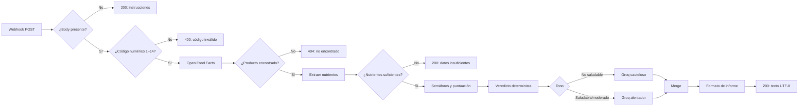
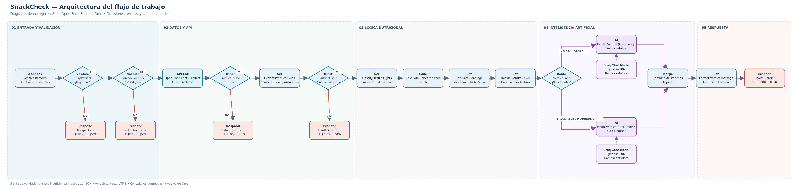

# SnackCheck — Verificador nutricional con n8n e IA

**Versión documentada:** 1.0.0 (proyecto académico, 4Geeks)  
**Estado:** prototipo funcional evaluado; no es un sistema médico ni un servicio público listo para producción.

## Descripción
SnackCheck recibe un código de barras por HTTP POST, consulta Open Food Facts, extrae información nutricional por 100 g, aplica reglas explícitas y utiliza Groq para redactar una explicación breve en español. El modelo **no decide el veredicto**: ese resultado se calcula antes de la etapa de IA.

## Arquitectura



El diagrama editable se incluye en `SnackCheck_diagrama.excalidraw`. También se adjuntan `SnackCheck_arquitectura.png` (imagen) y `SnackCheck_arquitectura.svg` (versión vectorial). El nuevo diagrama representa la topología revisada del workflow, con decisiones en rombos y salidas separadas.



## Interfaz HTTP

- **Método:** `POST`
- **Ruta:** `/webhook/nutrition-check` (URL de producción; durante las pruebas, `/webhook-test/nutrition-check`)
- **Cuerpo:** JSON `{"barcode":"3017620422003"}`
- **Código:** 1 a 14 dígitos, conforme a las reglas implementadas; esta verificación **no valida el dígito de control EAN/UPC**.
- **Salida exitosa:** texto en español con nombre, marca, veredicto, Nutri-Score, indicadores, calorías y explicación generada.

### Ejemplo de solicitud

```bash
curl -X POST 'https://TU_INSTANCIA.n8n.cloud/webhook/nutrition-check' \
  -H 'Content-Type: application/json' \
  -d '{"barcode":"3017620422003"}'
```

### Respuestas configuradas

| Situación | Código HTTP | Formato |
|---|---:|---|
| Body vacío `{}` | 200 | JSON de instrucciones |
| Código ausente, no numérico o fuera de 1–14 dígitos | 400 | JSON `invalid_barcode` |
| Producto inexistente en la respuesta esperada de la API | 404 | JSON `product_not_found` |
| Producto con nutrientes faltantes | 200 | JSON `insufficient_data` |
| Producto con datos suficientes | 200 | Texto plano UTF-8 |

**Nota:** el 200 de `insufficient_data` es una decisión del ejercicio, no una recomendación universal de diseño de APIs.

## Reglas nutricionales del proyecto

- Azúcar: **bajo** si <5 g/100 g, **medio** si 5–22,5 g, **alto** si >22,5 g.
- Sal: **alto** si >1,5 g/100 g; en otro caso, **ok**.
- Grasa total: **alto** si >17,5 g/100 g; en otro caso, **ok**.
- `concernScore`: suma de las categorías `alto` (0–3).
- Lectura por semáforos: 0 = saludable, 1 = moderado, 2–3 = no saludable.
- Lectura Nutri-Score: A/B = saludable, C = moderado, D/E = no saludable; `unknown` = no disponible.
- Veredicto: prevalece la categoría más desfavorable de las dos lecturas.

Estas son **reglas simplificadas del proyecto**, no sustituyen una evaluación nutricional profesional ni reproducen el algoritmo oficial de Nutri-Score.

## Tecnologías y responsabilidades

- **n8n:** orquesta nodos, bifurcaciones y respuestas HTTP.
- **Open Food Facts API v2:** fuente externa de datos del producto; su contenido puede ser incompleto o cambiar.
- **Code/Set/IF:** convierten los datos en clasificaciones y veredictos reproducibles.
- **Groq + `openai/gpt-oss-20b`:** redacta el texto de una de dos ramas (cautelosa/alentadora) sin recalcular la clasificación.
- **Postman:** cliente HTTP usado para las pruebas manuales.

## Instalación y puesta en marcha

1. Importa `SnackCheck_workflow_publicable.json` en n8n.
2. Abre ambos nodos de modelo de Groq y **vincula tus propias credenciales**. Las referencias originales se excluyeron del JSON publicable.
3. Cambia `CONFIGURAR_CORREO_PROPIO` en la cabecera `User-Agent` de Open Food Facts por un contacto real apropiado para tu aplicación.
4. Revisa el `Webhook` y verifica que esté configurado para responder mediante nodos `Respond to Webhook`.
5. Para pruebas: pulsa **Execute** en el canvas completo de n8n y envía un POST a la URL `webhook-test` desde Postman. Para uso continuo: publica/activa el workflow y utiliza la URL de producción.
6. Verifica respuestas y códigos HTTP; no publiques claves secretas ni información privada.

## Limitaciones conocidas

- No hay autenticación ni límites propios de uso en el Webhook; no se recomienda exponerlo públicamente sin controles.
- No se distingue explícitamente entre error temporal de Open Food Facts y producto no encontrado: se necesita una rama específica para fallos de la API.
- No existe mecanismo propio de reintentos, timeout y fallback de Groq documentado en el flujo.
- La salida textual de la IA puede variar; la instrucción del prompt reduce errores pero no los garantiza ausentes.
- Las reglas simplificadas no consideran el contexto completo de la dieta, tamaño de porción ni necesidades individuales.
- Es posible que una consola antigua no muestre emojis correctamente; Postman confirmó caracteres legibles.
- El workflow exportado está `active: false`; la URL de prueba requiere ejecución manual.

## Pruebas y evidencia

Consultar `TEST-REPORT.md`. Se distinguen ejecuciones reales en Postman de simulaciones internas. No se atribuyen códigos HTTP no observados explícitamente.

## Seguridad del repositorio

El JSON publicable no incluye identificadores de credenciales ni correo de contacto del export original. No agregues archivos `.env`, claves de Groq, tokens o solicitudes con datos sensibles al repositorio.

## Documentos incluidos

`README.md`, `TEST-REPORT.md`, `CHANGELOG.md`, `SnackCheck_diagrama.excalidraw`, `SnackCheck_workflow_publicable.json`.


## Validación de rendimiento y producción (2026-11-02)

Cinco ejecuciones consecutivas de Nutella finalizaron correctamente, con duraciones de 3.167 s, 1.219 s, 1.504 s, 1.515 s y 2.446 s (promedio **1.9702 s**). Se obtuvo un informe completo usando la URL de producción sin activar manualmente el editor; el código HTTP 200 de esa solicitud queda pendiente de confirmación explícita. Los tiempos de Open Food Facts y Groq por separado no se visualizaron. Estos resultados no constituyen una garantía de rendimiento.

**Archivo incluido:** copia pública del JSON revisada a partir de la última exportación documentada, con 23 nodos y 3 Sticky Notes, sin credenciales; se actualizaron únicamente los dos nombres de modelos Groq según la corrección académica. La disposición visual y las notas del editor se conservan desde la exportación disponible.

## Versión final exportada (2026-11-02)
- Exportación confirmada: **23 nodos funcionales y 3 Sticky Notes**; 23 nodos tienen texto de notas.
- Nodos renombrados: `Route - Verdict Tone` y `Merge - Combine AI Branches`.
- `pinData` vacío; flujo publicado y respuesta de Nutella observada por la URL de producción.
- El JSON compartido elimina referencias de credenciales, identificadores internos y sustituye el correo en User-Agent por un marcador. **Después de importar, configura una credencial Groq y un correo de contacto adecuado**. La copia compartida no está activada automáticamente.
- En la exportación original, la nota de `API Call - Open Food Facts Product` estaba guardada pero `Display Note in Flow` no estaba activo; la copia publicable lo activa para visualizar la documentación.
## Comprobaciones finales de la entrega (2026-11-02)

- Evidencia HTTP adicional: body vacío (200), código alfanumérico (400), campo incorrecto (400), producto desconocido (404).
- Prueba real Nutri-Score A: `8410505192216`, respuesta HTTP 200, clasificación `SALUDABLE`, preocupación 0/3. El nombre del producto no llegó desde la fuente y se mostró el valor de respaldo `Producto sin nombre` con marca Luengo.
- El diagrama Excalidraw se reeditó con rombos y rutas de error visibles, sin cambiar el algoritmo del workflow.
- La rama de datos insuficientes fue validada con datos simulados; aún no consta una prueba externa completa con un producto real sin nutrientes.
- Las capturas de pruebas depuradas (sin datos del navegador ni espacio personal) se encuentran en `evidencias/`.
- Las comprobaciones de códigos HTTP se realizaron en una instancia existente de n8n; al importar el JSON público deben configurarse de nuevo las credenciales y publicarse el workflow en la instancia de destino.
